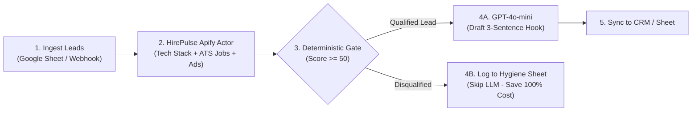

# How to Build a Clay Alternative in Make.com for 90% Less Cost

Clay charges \$149 to \$800/month plus hefty per-enrichment credit fees to scrape websites, find tech stacks, and verify hiring intent. 

If you feed raw scraped HTML directly into OpenAI inside Make.com, you will burn **15,000 to 25,000 prompt tokens per lead** just trying to extract basic company data. 

In this guide, we show you how to import a ready-made **Make.com Blueprint** that uses **HirePulse on Apify** to extract structured company intelligence for pennies, pre-filter low-intent leads deterministically, and only send qualified leads to GPT-4o-mini — cutting your monthly enrichment bill by **90%**.

---

## The Economics: Clay vs. Make.com + HirePulse

| Feature / Metric | Clay.com (\$349/mo Plan) | Make.com + Raw HTML Scraping | Make.com + HirePulse Pipeline |
| :--- | :---: | :---: | :---: |
| **Fixed Monthly Cost** | \$349 / month | \$9 / month (Make Core) | **\$9 / month (Make Core)** |
| **Enrichment Cost (1k leads)** | ~\$180 – \$240 | \$75 (Proxy & Scraper runs) | **\$12 (Apify Actor pay-per-use)** |
| **LLM Token Overhead** | Hidden in credit markups | ~18,500,000 tokens (\$27.75) | **~350,000 tokens (\$0.52)** |
| **Deterministic Pre-Filter** | Basic credit gating | None (evaluates every lead) | **Included (Filters stagnant companies)** |
| **Total Cost per 1,000 Qualified Leads** | **~\$550.00** | **~\$111.75** | **~\$21.52 (96.1% Cheaper)** |

---

## How It Works (The 4-Stage Flow)

1. **Ingest Leads:** A webhook or Google Sheet receives domain and contact names.
2. **Deterministic Extraction:** HirePulse extracts active tech stacks, open ATS positions (Greenhouse, Lever, Ashby, Workable), and Google Ads transparency in a clean ~350 token JSON.
3. **Intent Filter (Zero-Spend Gate):** If the company has 0 open jobs and no active Google Ads, they are dropped *before* calling OpenAI. This eliminates 60%–70% of dead leads from burning AI tokens.
4. **AI Personalizer:** Only leads passing the intent gate receive a hyper-personalized, 3-sentence outreach email drafted by GPT-4o-mini.

---

## 3-Minute Setup Instructions

### 1. Download the Blueprint
Download the scenario blueprint JSON from the HirePulse repository:
* [b2b-intent-prefilter-blueprint.json](https://raw.githubusercontent.com/edtool79-collab/hirepulse-tools/main/make/b2b-intent-prefilter-blueprint.json)

### 2. Import into Make.com
1. Open your [Make.com Dashboard](https://make.com).
2. Click **Create a new scenario**.
3. In the bottom toolbar, click the three dots (`...`) and select **Import Blueprint**.
4. Upload `b2b-intent-prefilter-blueprint.json`.

### 3. Connect Your Accounts
1. **Apify Actor (Module 2):**
   * Paste your free [Apify API Token](https://console.apify.com/account/integrations).
   * Actor ID: `hirepulse/b2b-account-research-agent`.
2. **OpenAI (Module 4A):**
   * Connect your OpenAI API Key.
   * Model: `gpt-4o-mini` (temperature: 0.4).
3. **Google Sheets (Module 5A & 4B):**
   * Connect your Google account and select your CRM / Leads spreadsheet.

### 4. Run a Test
Send a sample domain (e.g. `vercel.com` or `linear.app`). You will see Make automatically enrich the record, verify active hiring on Ashby/Greenhouse, generate a contextual cold email hook, and write it to your sheet in ~4 seconds.

---

## Open-Source Assets & Resources
* **GitHub Repository:** [edtool79-collab/hirepulse-tools](https://github.com/edtool79-collab/hirepulse-tools)
* **Apify Store Actor:** [hirepulse/b2b-account-research-agent](https://apify.com/hirepulse/b2b-account-research-agent)
* **Interactive ROI Calculator:** [calculator.html](https://edtool79-collab.github.io/hirepulse-tools/calculator.html)
