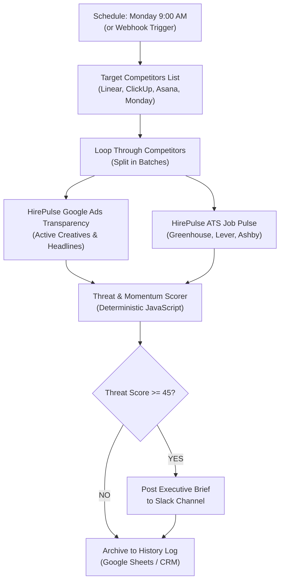

# Automated Competitor Ad Spy & ATS Hiring Surge Radar (Free n8n Template)

> **Continuous Competitive Intelligence for Growth & Sales Teams**  
> Monitor your top competitors' active Google Ads creatives, new messaging angles, and applicant tracking system (ATS) hiring velocity every Monday at 9:00 AM—with zero manual checks.

---

## 🎯 Executive Overview

Most B2B companies find out their competitor launched a major new product or aggressive marketing campaign weeks after the fact—when a prospect brings it up on a demo call.

Dedicated competitor tracking tools (SpyFu, SEMrush, SimilarWeb) charge **$150–$400/month per seat** for static reports that nobody reads.

This **free, open-source 12-node n8n template** automates competitor intelligence directly into your team's Slack channel or CRM:
1. **Google Ads Transparency Radar:** Inspects live active search and display ad creatives, headline copy, and first/last seen dates.
2. **ATS Hiring Radar:** Queries public job board JSON endpoints (Greenhouse, Lever, Ashby) to see which departments are hiring (e.g. 5+ new Account Executives = outbound expansion; 4 ML Engineers = new AI product build).
3. **Deterministic Threat Score (0–100):** Evaluates overall competitive momentum deterministically without LLM hallucination.
4. **Slack Alert:** Sends a rich executive alert only when a competitor exceeds the threat threshold (Score >= 45).

---

## 🏗️ Architecture & Workflow Flowchart

---

## 📥 Download & Quickstart

### Step 1: Import Workflow JSON
1. Download or copy the workflow JSON:
   👉 **[3-automated-competitor-ad-spy-and-intel.json](../n8n/3-automated-competitor-ad-spy-and-intel.json)**
2. In your n8n instance, go to **Workflows** > **Add workflow** > click `...` > **Import from File**.

### Step 2: Configure Credentials
- **Apify API Token:** Get your personal free API token from [console.apify.com/account/integrations](https://console.apify.com/account/integrations).
- **Slack Incoming Webhook:** Paste your Slack incoming webhook URL in the `Post Alert to Slack Channel` node.

### Step 3: Run & Customize
- Edit the `Target Competitors Input` code node to add your specific competitor domains (e.g. `['competitor1.com', 'competitor2.com']`).
- Set your preferred alert threshold in `Is Threat >= 45?`.

---

## ⚖️ Pricing & Economics

| Operation | Legacy Enterprise Scrapers | HirePulse n8n Workflow |
| :--- | :--- | :--- |
| **Monthly Subscription** | $199–$499 / mo | **$0.00** |
| **Data Cost per Competitor** | Included in quota | **$0.015** (only charged when ads exist) |
| **Weekly Cost (20 Competitors)** | High base fee | **~$1.20 / month** |
| **Notification Latency** | Monthly PDF | **Immediate (Real-Time Slack Alerts)** |
