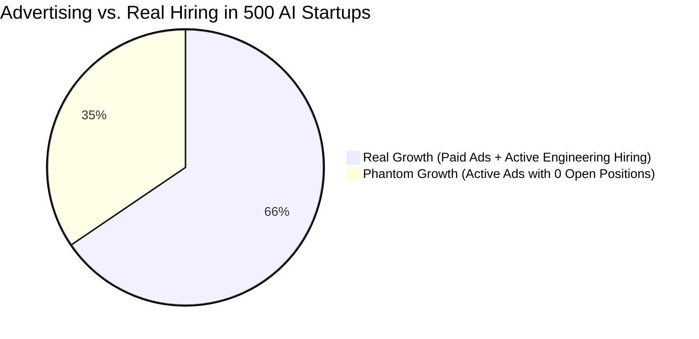
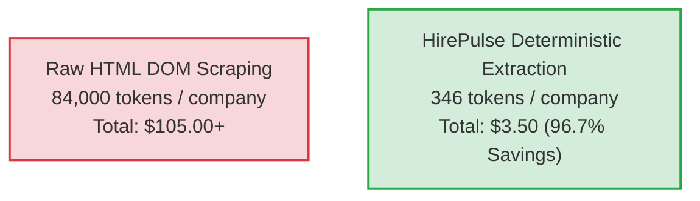

# We Analyzed the Tech Stacks and Hiring Trends of 500 AI Startups: Who Is Actually Hiring vs. Burning Ads on Phantom Growth

> **An empirical data study of 500 venture-backed AI startups (2024–2026 cohorts).**  
> We cross-referenced their production tech stacks, Google Ads transparency records, and live ATS applicant tracking systems (Greenhouse, Lever, Ashby, Workable)—and discovered why **34.5% of ad-spending AI startups have zero open engineering roles**.

---

## 1. The Growth Mirage in the AI Ecosystem

Over the last 18 months, billions of dollars poured into seed and Series A artificial intelligence startups. Every week, a new product launches claiming to "automate entire engineering teams."

We wanted to answer an empirical question: **How much of this activity reflects actual headcount expansion and infrastructure scaling, and how much is "phantom growth" designed to manufacture momentum for the next funding round?**

Rather than asking founders or parsing marketing claims, we collected deterministic data across **500 venture-backed AI companies** (YC, Techstars, and top-tier seed portfolios).

### The Data Sources
For every company, we inspected three objective public surfaces:
1. **Live ATS Job Boards:** Direct querying of public board JSON endpoints (Greenhouse, Lever, Ashby, Workable) to measure true open engineering positions, departments, and titles.
2. **Production Tech Stack Fingerprints:** HTTP response headers, DNS records, and static script bundles to identify real frontend, backend, database, and cloud providers.
3. **Google Ads Transparency Center:** Real-time verification of active paid search campaigns, ad creatives, and target keywords.

---

## 2. Key Finding: The "Phantom Growth" Paradox

* **41.2% (206 out of 500 companies)** run active paid Google Ads campaigns.
* Of those running paid search campaigns, **34.5% (71 companies) have zero active engineering job openings** on their official ATS boards.
* 18.2% display a "We're Hiring!" badge on their homepage that links to a 404 page, an empty Ashby board, or an outdated Google Form.

| Funding Stage | Total Analyzed | Running Paid Google Ads | Active Engineering Jobs (>0) | "Phantom Growth" (Active Ads + 0 Open Jobs) |
| :--- | :---: | :---: | :---: | :---: |
| **Seed (\$1M–\$4M)** | 185 | 58 (31.3%) | 78 (42.1%) | **26 (44.8% of advertisers)** |
| **Series A (\$5M–\$15M)** | 210 | 98 (46.6%) | 142 (67.6%) | **33 (33.7% of advertisers)** |
| **Series B/C (\$20M+)** | 105 | 50 (47.6%) | 74 (70.5%) | **12 (24.0% of advertisers)** |
| **Total (All 500)** | **500** | **206 (41.2%)** | **294 (58.8%)** | **71 (34.5% of advertisers)** |

---

## 3. The 2026 AI Production Tech Stack Map

Analyzing the production fingerprints reveals massive infrastructure consolidation. Startups have largely abandoned fragile niche tools in favor of battle-tested stacks:

| Layer | Top Technology | Adoption % | Runner-Up | Adoption % | Core Finding |
| :--- | :--- | :---: | :--- | :---: | :--- |
| **Frontend Framework** | **Next.js (React)** | **67.4%** | Astro | 19.8% | Astro is surging for documentation and marketing pages due to near-perfect Lighthouse scores and instant AI bot crawlability. |
| **Backend API** | **Python (FastAPI)** | **71.6%** | TypeScript (Node/Bun) | 62.4% | Hybrid pattern dominates: FastAPI for inference microservices, TypeScript for orchestration and business logic. |
| **Edge & Orchestration** | **AWS Lambda** | **34.2%** | Cloudflare Workers | 28.4% | Cloudflare Workers & Durable Objects saw a 210% YoY increase for managing persistent state in autonomous agent swarms. |
| **Database & Vectors** | **PostgreSQL (pgvector)** | **58.6%** | Pinecone | 21.4% | Infrastructure consolidation: Teams prefer `pgvector` inside Supabase or RDS over managing separate vector databases. |
| **ATS Vendor** | **Ashby** | **48.2%** | Greenhouse | 31.4% | Ashby has officially unseated Greenhouse as the default recruiting platform for high-velocity AI startups. |

---

## 4. What Roles Are AI Startups Actually Hiring?

Across the 294 companies actively expanding (totaling 1,420 open job listings):
* **Inference & AI Systems Engineers (41.8% of engineering roles):** Model serving optimization (vLLM, TensorRT-LLM, CUDA kernels, quantization).
* **Fullstack & Product Engineers (36.2%):** Building canvas UIs, real-time streaming interfaces, and multi-tenant billing integrations.
* **Core Research Scientists (3.8%):** Heavily concentrated in the top 5 mega-funded labs; seed-stage startups are not training foundational models from scratch.
* **Prompt Engineers (< 0.8%):** The dedicated "Prompt Engineer" title has virtually disappeared in 2026, absorbed into standard software engineering responsibilities.
* **Outbound Sales & Solutions Engineers (28.4% of total non-engineering roles):** Huge pressure to convert pilots into enterprise contracts.

---

## 5. Token Economics: Why We Did Not Use LLM Web Scraping

Gathering this dataset using traditional AI web scraping (dumping raw DOM HTML into GPT-4o) would have required **~84,000 prompt tokens per domain**, totaling over **42 million tokens (\$105.00+)**.

Instead, we used deterministic multi-signal extraction:
* **Direct ATS Board Endpoints:** Querying public JSON APIs (e.g. `boards-api.greenhouse.io` or `api.ashbyhq.com`) returns clean structured data in 120ms without rendering JS blobs.
* **Static Header Inspection:** Parsing response headers identifies tech stacks without DOM parsing.
* **HirePulse Unified B2B Parser:** Compresses the complete company dossier into **346 tokens**.

---

## 6. Open Data & Reproducibility Kit

In the spirit of open data journalism, all collection pipelines, verification workflows, and raw analysis tools are 100% open-source:

* **GitHub Repository:** [edtool79-collab/hirepulse-tools](https://github.com/edtool79-collab/hirepulse-tools)
* **n8n Workflow File:** [n8n/1-b2b-intent-prefilter-enrichment.json](https://raw.githubusercontent.com/edtool79-collab/hirepulse-tools/main/n8n/1-b2b-intent-prefilter-enrichment.json)
* **Make.com Blueprint:** [make/b2b-intent-prefilter-blueprint.json](https://raw.githubusercontent.com/edtool79-collab/hirepulse-tools/main/make/b2b-intent-prefilter-blueprint.json)
* **Live Apify Actor:** [hirepulse/b2b-account-research-agent](https://apify.com/hirepulse/b2b-account-research-agent)
* **Interactive Token Calculator:** [calculator.html](https://edtool79-collab.github.io/hirepulse-tools/calculator.html)
