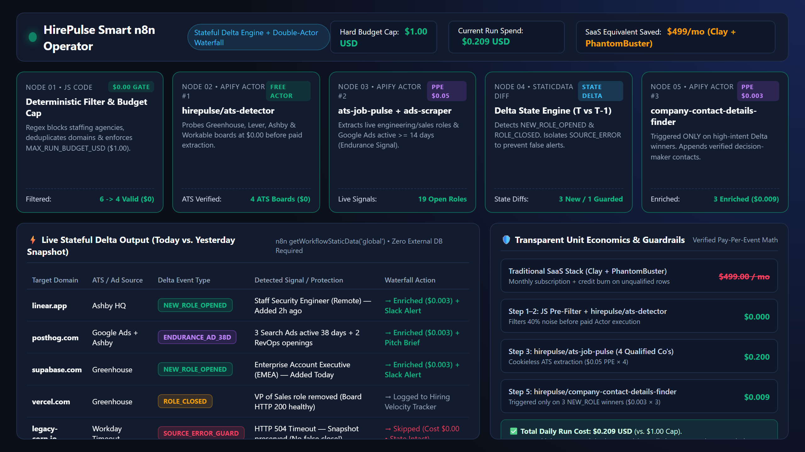
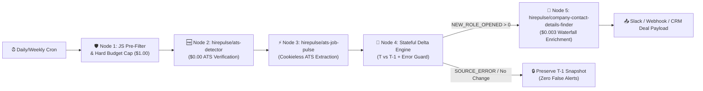

# ⚡ HirePulse Smart n8n Operator & Stateful B2B Signal Suite

> **Production-grade, state-aware n8n operators for cookieless ATS hiring-intent deltas, 14+ day ad endurance signals, and hard budget-capped B2B enrichment.**

🎥 **[Watch Live Operator Video Demo (`smart-operator-demo.webm`)](./assets/smart-operator-demo.webm)** | 🧩 **[Interactive HTML Visualizer (`demo-visualizer.html`)](./demo-visualizer.html)**

---

## 🔥 Flagship Stateful Delta Operators (2026 Edition)

Unlike one-off "toy" scrapers that dump static lists and burn credits on the same rows every day, these operators implement **Stateful Delta Tracking (`T` vs `T-1`)**, **Hard Budget Guardrails (`MAX_RUN_BUDGET_USD`)**, and **Double-Actor Waterfalls**:

### 1. [`ats-hiring-delta-radar.json`](./ats-hiring-delta-radar.json) — Cookieless ATS Hiring-Intent Delta & Contact Waterfall
- **📥 1-Click n8n Import URL:** `https://raw.githubusercontent.com/edtool79-collab/hirepulse-tools/main/n8n/ats-hiring-delta-radar.json`
- **What It Solves:** Monitors target accounts daily/weekly across Greenhouse, Lever, Ashby, and Workable **100% cookieless** (zero `li_at` session cookies, zero LinkedIn account ban risk).
- **3-Stage Double-Actor Waterfall:**
  1. **Free Gate ($0.00):** Runs [`hirepulse/ats-detector`](https://apify.com/hirepulse/ats-detector) first to verify an active ATS board exists before spending a cent.
  2. **Live Board Extraction ($0.05 PPE):** Runs [`hirepulse/ats-job-pulse`](https://apify.com/hirepulse/ats-job-pulse) only on verified boards.
  3. **Stateful Delta Diff Engine (`getWorkflowStaticData`):** Compares today's open roles against the previous snapshot and emits:
     - `NEW_ROLE_OPENED`: Newly opened engineering/sales/AI roles.
     - `ROLE_CLOSED`: Previously open roles removed from a healthy (`HTTP 200`) board.
     - `SOURCE_ERROR_GUARD`: Isolates network timeouts (`504/429`) so a failed scrape **never** wipes your state snapshot or triggers false closure alerts.
  4. **Conditional Contact Waterfall ($0.003 PPE):** Triggers [`hirepulse/company-contact-details-finder`](https://apify.com/hirepulse/company-contact-details-finder) **only** when `NEW_ROLE_OPENED > 0`.

### 2. [`competitor-ads-longevity-radar.json`](./competitor-ads-longevity-radar.json) — Competitor Google Ads Endurance (14+ Days) & Correlated Intent Radar
- **📥 1-Click n8n Import URL:** `https://raw.githubusercontent.com/edtool79-collab/hirepulse-tools/main/n8n/competitor-ads-longevity-radar.json`
- **What It Solves:** Most competitor ad alerts notify you of 48-hour A/B test failures. This operator tracks **Ad Endurance (`active_days >= 14`)** via [`hirepulse/google-ads-transparency-scraper`](https://apify.com/hirepulse/google-ads-transparency-scraper) and correlates sustained ad spend with live hiring intent via [`hirepulse/company-intent-radar`](https://apify.com/hirepulse/company-intent-radar).
- **Stateful Diffs:** Alerts only on `NEW_ENDURANCE_WINNER_14D`, `NEW_CAMPAIGN_DETECTED`, or `CAMPAIGN_PAUSED`.

---

## 🛡️ Transparent Dependencies & Hard Cost Cap Table

We believe in **100% honest unit economics**—no hidden $149/mo SaaS dependencies, no fake "free" claims:

| Component / Stage | Actor / Service Used | Pricing Model | Exact Unit Cost | Hard Cap Guardrail |
| :--- | :--- | :--- | :--- | :--- |
| **Orchestration & State** | `n8n` (Self-hosted or Cloud) + `getWorkflowStaticData` | Built-in JS Code Node | **$0.00** | Zero external DB required |
| **Stage 1: Pre-Filter & Cap** | Deterministic JS Regex + Deduplication | Built-in JS Code Node | **$0.00** | Enforces `MAX_RUN_BUDGET_USD = $1.00` |
| **Stage 2: ATS Board Probe** | [`hirepulse/ats-detector`](https://apify.com/hirepulse/ats-detector) | Free Utility Actor | **$0.00 Actor Fee** | Drops non-ATS domains before paid runs |
| **Stage 3A: Live ATS Jobs** | [`hirepulse/ats-job-pulse`](https://apify.com/hirepulse/ats-job-pulse) | Pay-Per-Event (PPE) | **$0.05 / company** | Max 20 companies/run at $1.00 default cap |
| **Stage 3B: Google Ads Spy** | [`hirepulse/google-ads-transparency-scraper`](https://apify.com/hirepulse/google-ads-transparency-scraper) | Pay-Per-Event (PPE) | **$0.005 / domain + $0.0015 / ad** | Filtered by `MIN_ACTIVE_DAYS = 14` |
| **Stage 4: Contact Waterfall** | [`hirepulse/company-contact-details-finder`](https://apify.com/hirepulse/company-contact-details-finder) | Pay-Per-Event (PPE) | **$0.003 / domain** | Runs **ONLY** on verified `NEW_ROLE_OPENED` deltas |

> **💡 Apify Free Tier Note:** Every free [Apify account](https://apify.com/hirepulse) includes **$5.00/month** in free platform usage credits—enough to run ~90 full company delta checks per month at $0 out-of-pocket before scaling to a paid plan.

---

## 📦 Complete Workflow Catalog in This Repository

| File | Primary Use Case | Chained HirePulse Actors |
| :--- | :--- | :--- |
| **[`ats-hiring-delta-radar.json`](./ats-hiring-delta-radar.json)** | Daily/Weekly Cookieless ATS Job Delta (`NEW_ROLE_OPENED` / `ROLE_CLOSED`) + Contact Waterfall | `ats-detector` → `ats-job-pulse` → `company-contact-details-finder` |
| **[`competitor-ads-longevity-radar.json`](./competitor-ads-longevity-radar.json)** | Weekly 14+ Days Google Ads Endurance Signal + Hiring Intent Correlation | `google-ads-transparency-scraper` → `company-intent-radar` |
| **[`0-super-b2b-lead-enrichment-waterfall.json`](./0-super-b2b-lead-enrichment-waterfall.json)** | 3-Step Waterfall (Tech Stack + ATS Jobs + Google Ads + Decision-Maker Contacts) | `website-tech-stack-detector` → `ats-job-pulse` → `google-ads-transparency-scraper` → `company-contact-details-finder` |
| **[`1-b2b-intent-prefilter-enrichment.json`](./1-b2b-intent-prefilter-enrichment.json)** | Deterministic ICP Pre-Filter (0–100 Score) before LLM Cold Outreach Hook | `company-intent-radar` |
| **[`2-competitor-ads-and-hiring-monitor.json`](./2-competitor-ads-and-hiring-monitor.json)** | Monday 9AM Competitor Hiring & Search Ads Slack Alert | `ats-job-pulse` + `google-ads-transparency-scraper` |
| **[`3-automated-competitor-ad-spy-and-intel.json`](./3-automated-competitor-ad-spy-and-intel.json)** | Competitor Ad Spy & Threat Score (0–100) War Room Brief | `google-ads-transparency-scraper` + `ats-job-pulse` |
| **[`4-zero-token-icp-router-and-enrichment.json`](./4-zero-token-icp-router-and-enrichment.json)** | Zero-Token JavaScript ICP Router & CRM Hygiene | `website-tech-stack-detector` + `company-contact-details-finder` |

---

## 🏗️ Stateful Delta Architecture (`ats-hiring-delta-radar.json`)

---

## 🚀 2-Minute Import & Setup Guide

1. **Install Community Node (Optional) or Use Built-In HTTP:**
   - The workflows support `@apify/n8n-nodes-apify` out of the box, or standard n8n `HTTP Request` nodes.
2. **Import via URL in n8n:**
   - Open n8n → **Workflows** → **Import from URL** → paste:
     - `https://raw.githubusercontent.com/edtool79-collab/hirepulse-tools/main/n8n/ats-hiring-delta-radar.json`
     - `https://raw.githubusercontent.com/edtool79-collab/hirepulse-tools/main/n8n/competitor-ads-longevity-radar.json`
3. **Connect Your Apify Token:**
   - Grab your API token from [Apify Console → Integrations](https://console.apify.com/account/integrations) and add it to the **Apify account** credential in n8n.
4. **Customize Target Domains & Budget Cap:**
   - Open **Node 1 (`Pre-Filter & Hard Budget Cap`)** and adjust `MAX_RUN_BUDGET_USD` (default `1.00`) and your `target_domains` array.
