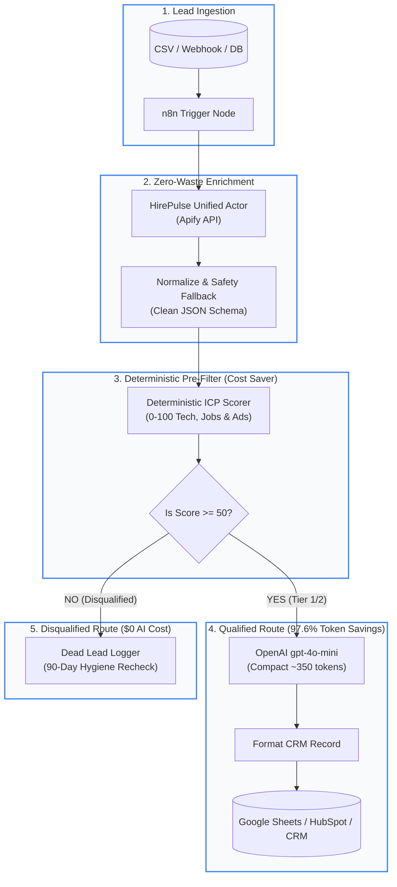

# ⚡ HirePulse n8n Growth Suite

> **Production-grade n8n workflows for zero-waste B2B lead enrichment, deterministic ICP intent filtering, and competitor hiring/ads intelligence.**

Stop burning thousands of dollars on enterprise seat licenses and stop wasting 15,000+ LLM tokens per lead on messy raw HTML DOM scraping.

---

## 🎯 What's Inside

1. **`1-b2b-intent-prefilter-enrichment.json`**:
   - **Unified Data Enrichment:** Enriches domains via Apify HirePulse actors (Tech Stack, Open Positions, Google Ads Signals) in a single compact payload.
   - **Deterministic ICP Pre-Filter:** Evaluates qualification via zero-cost JavaScript rules *before* calling AI models. Discards 60–80% of poor fits automatically.
   - **97.6% Token Reduction:** Replaces 15,000–25,000 raw HTML scraper tokens with clean ~350-token structured JSON.
   - **Hyper-Personalized Outreach:** Calls `gpt-4o-mini` only for pre-qualified Tier-1 accounts to craft 3-sentence high-converting cold hooks.
   - **Two-Way Routing:** Automatically syncs qualified leads to CRM / Google Sheets and logs disqualified leads for cold CRM hygiene.

2. **`2-competitor-ads-and-hiring-monitor.json`**:
   - **Automated Monday 9AM Scan:** Regularly checks your key target accounts and competitors.
   - **ATS Growth Pulse:** Scrapes live jobs on Greenhouse, Lever, and Workday.
   - **Google Ads Transparency Radar:** Detects live search ad spend and creative messaging.
   - **Instant Slack Alerts:** Sends actionable alerts directly to `#growth-signals` when hiring surges are detected.

3. **3-automated-competitor-ad-spy-and-intel.json**:
   - **Competitor Ad Spy & Threat Radar:** Automated Monday 9AM scan of competitor ad creatives, search conquesting copy, and ATS talent expansion.
   - **Deterministic Threat Scoring (0–100):** Weighted algorithmic scoring combining Google Ads volume and engineering/sales headcount momentum.
   - **Slack War Room Alerts:** Rich Block Kit notifications with AI-synthesized 3-bullet executive counter-strategy.
   - **Full Guide:** [Automated Competitor Ad Spy Guide](../guides/n8n-competitor-ad-spy.md).

---

## 🏗️ Architecture & Workflow Pipeline

---

## 💰 The Math: HirePulse + n8n vs. Legacy Subscriptions

| Feature / Metric | Clay (Pro/Enterprise) | Apollo.io (Custom) | Raw Web Scraping + AI | **HirePulse + n8n Suite** |
| :--- | :--- | :--- | :--- | :--- |
| **Base Monthly Cost** | $149 – $800 / mo | $99 – $300 / mo | $0 (Self-hosted) | **$0 (Self-hosted n8n)** |
| **Enrichment Cost per Lead** | $0.05 – $0.20 / lead | $0.08 – $0.15 / lead | ~$0.005 | **~$0.005 – $0.01 (Pay-per-result)** |
| **LLM Token Prompt Overhead** | 5,000 – 10,000 tokens | N/A (Generic AI) | 15,000 – 25,000 tokens | **~350 tokens (97.6% reduction)** |
| **Filter Stage Timing** | Post-AI billing | Post-credit deduction | Post-LLM extraction | **Pre-AI (Deterministic JavaScript)** |
| **Disqualified Lead Waste** | Paid full credit price | Paid full credit price | Paid 15k prompt tokens | **$0.000 spent on AI** |
| **Total Cost for 1,000 Leads** | **~$250.00** | **~$180.00** | **~$65.00** | **~$6.50 – $8.00** |

### Why Deterministic Pre-Filtering Matters
Most B2B lead lists contain 60–80% unqualified businesses (stagnant headcount, legacy tech stack, zero marketing spend).
- **The naive approach:** Send every lead's scraped HTML (15k tokens) directly to an LLM. For 1,000 leads, you burn 15,000,000 tokens ($37.50 on GPT-4o) just to discover 700 of them were useless.
- **The HirePulse n8n approach:** The JavaScript Code node deterministically scores leads. Only the 300 qualified leads reach the LLM, using only 350 tokens each. Total tokens burned: 105,000 tokens ($0.15 on GPT-4o-mini). **Over 99% total cost reduction.**

---

## 🚀 3-Minute Quickstart Guide

### Prerequisites
1. An active n8n instance (Self-hosted or n8n Cloud).
2. A free [Apify Account](https://apify.com) (includes $5/month free platform credits).
3. An OpenAI API Key (or Anthropic / Ollama for local LLM).

### Step 1: Import Workflow into n8n
1. In n8n, click **Workflows** > **Add workflow**.
2. Click the three dots `...` in the upper right corner > **Import from File**.
3. Select `1-b2b-intent-prefilter-enrichment.json`.

### Step 2: Set Credentials
- **Apify Account:** Create an Apify credential using your personal API token from your [Apify Console](https://console.apify.com/account/integrations).
- **OpenAI Account:** Enter your standard OpenAI API key.

### Step 3: Run & Verify
1. Click **Test workflow**.
2. The workflow will run the 3 included test accounts (`vercel.com`, `linear.app`, `legacy-local-plumbing-supply.example`).
3. Notice how `legacy-local-plumbing-supply` is automatically routed to `Log Disqualified Leads` without triggering OpenAI, while Vercel and Linear generate tailored 3-sentence outreach hooks and format clean CRM records.

---

## ⚙️ Customization & Production Hardening

- **Adjust ICP Criteria:** In the `Deterministic ICP Pre-Filter` node, customize `TARGET_KEYWORDS_TECH`, `MIN_SCORE_TO_QUALIFY`, and scoring weights according to your business needs.
- **Connect Real Destinations:** Replace the `Export to Google Sheets / CRM (Ready)` Set node with the official n8n nodes for **HubSpot**, **Salesforce**, **Notion**, **Airtable**, or **PostgreSQL**.
- **Replace Trigger:** Replace `When clicking "Test workflow"` with a **Webhook Trigger**, **Google Sheets Trigger**, or **Postgres Trigger** to enrich leads continuously in real time.

---

## 🔒 Security & Privacy Policy
- **Zero Hardcoded Secrets:** Credentials are decoupled into n8n credential stores.
- **Zero Spend Guarantee:** No hidden recurring fees or unauthorized credit cards; leverages standard pay-per-event Apify Actor quotas.
- **Fail-Safe Design:** Includes comprehensive schema fallback handlers to ensure zero pipeline breaks even on partial company profiles.
